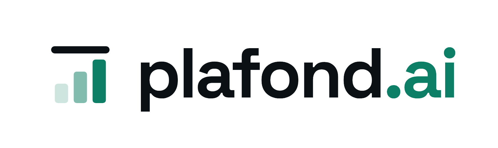

<p align="center">
<picture>
  <source media="(prefers-color-scheme: dark)" srcset="docs/assets/plafond-logo-transparent.png">
  
</picture>
</p>

<h3 align="center">Quel est votre pire scénario ?</h3>

<p align="center">Plafond vous dit combien vos agents IA peuvent perdre au maximum, maintenant et sur les prochaines 24 heures, et le réseau Kaspa l'impose, même si un agent est piraté.</p>

<p align="center"><a href="https://lamaz-dev.github.io/plafond/">Site</a> · <a href="https://github.com/lamaz-dev/plafond/releases/latest">Télécharger</a> · <a href="DEMO.fr.md">Lancer la démo</a> · <a href="ROADMAP.md">Feuille de route</a> · <a href="SECURITY.md">Sécurité</a></p>

# Plafond

Un moteur de risque pour agents IA, garanti par des covenants Kaspa. Le projet s'appelait auparavant `kaspa-agent-vault`.

Les agents ne se verront confier de l'argent à grande échelle que si leur exposition financière est mesurable, vérifiable et garantie. Plafond répond en permanence à une seule question, en quatre chiffres :

| | |
|---|---|
| **Perte maximale maintenant** | ce qui pourrait partir si tous les agents devenaient hostiles à l'instant |
| **Perte maximale sur 24 h** | la même chose, sur les prochaines 24 heures |
| **Couvert** | ce que le réseau impose lui-même |
| **Non couvert** | ce que la garantie n'atteint pas, dit clairement |

Les budgets, coffres et modes de paiement sont les moyens ; le pire scénario garanti est le produit ([spécification du moteur](spec/moteur-de-risque.md)).

*[English](README.md) · Français*

> ⚠️ **Prototype non audité, testnet-10 uniquement.** Ne déposez jamais de vrais KAS (mainnet) dans ces
> contrats. Le code est en revue publique avant audit : voir [`SECURITY.md`](SECURITY.md) pour signaler une
> faille en privé et [`BUG-BOUNTY.md`](BUG-BOUNTY.md) pour les règles.

**Statut**

- ✅ testnet-10
- ✅ **cœur v0.7, sans mémoire** : 289 octets, 5 paramètres, une seule règle pour l'agent (attendre en proportion de ce qu'on dépense), imposée par le verrou relatif du réseau ([contrat](contracts/coeur.sil))
- ✅ **adresse de retour** : même avec la clé du propriétaire, l'argent d'un coffre ne peut revenir qu'au coffre ou à l'adresse de retour choisie à la création (par défaut la trésorerie ; au choix un Ledger, une multisignature ou un conservateur)
- ✅ **courbe promise à la création** : la perte totale d'un mandat ne dépasse jamais `C × t / R`, plafonnée au capital, quoi que fasse l'agent ; démontrée sur papier et vérifiée par tests contre le vrai moteur de Kaspa ([preuve](spec/borne-de-perte-v0.6.md), [comparaison avec la v0.5.1](spec/comparaison-v0.5.1-v0.6.md))
- 🧪 ardoise (prototype) : micropaiements répétés chez un vendeur, signés hors chaîne par l'agent et réglés en une seule transaction ; contrat de 35 lignes et tests contre le vrai moteur, commandes de l'outil à venir ([contrat](contracts/ardoise.sil))
- ✅ moteur de risque : perte maximale immédiate, sur 24 h, par agent et par vendeur, avec ce que la garantie ne couvre pas ([spécification](spec/moteur-de-risque.md)), affiché dans la console et vérifié par test contre le vrai moteur de Kaspa
- ✅ reproductible en une commande : `./verify-proof.sh`
- ✅ CI automatique à chaque envoi, campagne longue de fuzzing chaque semaine
- ⚠️ pas encore relu de façon indépendante, non audité
- ⚠️ aucun déploiement mainnet : ne pas utiliser avec des fonds réels

Historique : jusqu'à la v0.5.1, le coffre était un seau à jetons avec état et lignée KIP-20 ([preuve v0.5.1](spec/borne-de-perte.md)) ; il reste gelable par l'outil. Avis de sécurité : [faille de la limite par période en v0.4, corrigée en v0.5](spec/advisories/2026-11-20-v0.4-temps-mis-de-cote.md) · [constats de la première relecture indépendante, corrigés en v0.5.1](spec/advisories/2026-11-20-v0.5-relecture-independante.md).
>
> ⚠️ **Unaudited prototype, testnet-10 only.** Never deposit real (mainnet) KAS into these contracts.
> Public review before audit: report vulnerabilities privately as described in [`SECURITY.md`](SECURITY.md).

Coffre de dépenses pour agents IA sur Kaspa : l'agent paie seul ses services, mais ne peut
jamais dépasser le budget fixé par son propriétaire. La limite est imposée par le réseau
Kaspa (covenant SilverScript), pas par un logiciel.

## Architecture

```
contracts/   coeur.sil (le coffre, v0.7), DeliveryEscrow (paiement à la livraison), Ardoise ; ancien AgentBudget v0.5.1
tests/       tests des contrats dans le moteur de script de Kaspa ; l'outil a 94 tests, dont le fuzzing de la borne
cli/         outil en ligne de commande : déployer, payer, récupérer, démo x402 sur le testnet-10
spec/        spécification du profil x402 « covenant-budget » (paiement direct depuis le coffre)
testnet/     commandes à exécuter (commande.txt), journal des résultats, état public du coffre
.github/     exécution automatique sur le testnet via GitHub Actions
```

## Le coffre : cœur v0.6 (prototype non audité)

Une seule règle : pour dépenser une somme, la pièce du coffre doit avoir attendu un temps
proportionnel à cette somme depuis sa création. C'est le réseau Kaspa qui vérifie ce délai (verrou
relatif) : il n'y a ni compteur, ni date fournie par l'agent, ni état à suivre.

- **Quatre paramètres** : propriétaire, agent, capacité `C` (le plafond par achat, frais compris),
  période `R` (le temps pour regagner toute la capacité).
- **Courbe promise à la création** : perte totale au plus `C × t / R` au bout du temps `t`, jamais plus
  que le capital déposé. Un mandat neuf démarre à zéro et son budget se remplit au fil du temps.
- **L'adresse est l'identité du coffre** : le script ne change jamais. Un vendeur recompile le script
  à partir des quatre paramètres et vérifie la pièce sur la chaîne, sans indexeur ni lignée.
- **Un tiers de frais en moins** que la v0.5.1, et des coffres plus petits possibles (0,08 KAS).
- **Contrôle total du propriétaire** : rechargement (une pièce existante est regonflée : le rythme du mandat ne change pas), gel de toutes les pièces.
- **Ce que la v0.6 ne fait pas** : pas de rafale (un achat d'au plus `C`, puis attente), pas de liste
  blanche de vendeurs dans le contrat. Détail : [comparaison](spec/comparaison-v0.5.1-v0.6.md).

Modèle de menace : `spec/threat-model.md`. Prime aux bugs : `BUG-BOUNTY.md`.

## Le séquestre DeliveryEscrow (v0.3, prototype)

Paiement à la livraison : le vendeur n'est payé que contre une preuve de livraison signée par
un vérificateur pour cette commande et ce séquestre précis ; sans preuve dans le délai, l'argent revient au
propriétaire. Ni l'un ni l'autre ne peut détourner les fonds ni gonfler les frais.

## Profil x402 « covenant-budget »

Un agent paie un service x402 directement depuis son coffre. Le vendeur vérifie que le
coffre est authentique (recompilation du script à partir de ses quatre paramètres), qu'il est solvable (âge de la pièce lisible sur la
chaîne) et que la clé agent du coffre a autorisé cette requête, avant toute diffusion.
Le vendeur vérifie aussi que l'âge de la pièce couvre la dépense. Démo : commande `demo-x402` (voir `testnet/journal.md`). Spécification : `spec/kaspa-covenant-budget-v0.md`.

## Lancer les tests

Voir la section « Build & Test » du [README anglais](README.md#build--test) : tests de l'outil (dont fuzzing d'état), empreintes du bytecode, tests des contrats sur SilverScript figé.

## Testnet-10

Écrire les commandes dans `testnet/commande.txt` (`adresses`, `etat`, `deployer`,
`payer <sompi>`, `recuperer`) et pousser : GitHub Actions les exécute et écrit le
résultat dans `testnet/journal.md`. Les clés de test sont dérivées du secret
`VAULT_PHRASE` du dépôt.

## Sécurité

- Aucune clé, phrase secrète ou URL privée dans le dépôt : uniquement dans les secrets GitHub
  ou des fichiers `.env` ignorés.
- Clés dédiées à la démo, jamais réutilisées ailleurs.
- SilverScript n'a pas encore de version auditée : ne pas utiliser avec de vrais fonds.

## Travaux voisins

Plusieurs projets Kaspa travaillent sur le même problème : laisser un logiciel payer seul sans lui
confier toutes les clés. Plafond a commencé le 18 nov. 2026, après la plupart d'entre eux ; il
s'appuie sur leurs idées et ne prétend pas être le premier.

- **PolicyVault** (kenshido) : coffre à règles pour agents, sur le réseau principal depuis août 2026.
- **SompiVault** (elldeeone) : coffre à covenant ; Plafond reprend son principe de recharge comptée
  depuis le score DAA d'inscription du coffre (`OpTxInputDaaScore`, menace R34).
- **Kaspa x402** (elldeeone) : le profil de paiement x402 pour Kaspa. Le profil de Plafond l'étend
  et réutilise ses vecteurs de test sous licence MIT (voir [PROVENANCE.md](cli/vecteurs/kaspa-x402/PROVENANCE.md)).
- **k402 / kx402** (Kali123411) : paiements de style x402 sur Kaspa.
- **Warda** : contrôle des dépenses d'agents.

Ce que Plafond apporte : une borne de perte démontrée ([spec/borne-de-perte.md](spec/borne-de-perte.md))
et vérifiée contre le vrai moteur de script, un budget imposé par le covenant lui-même (agent
compromis et vendeur malhonnête réunis ne peuvent pas le dépasser), un plancher de survie calculé sur la masse KIP-9 (en dessous, le propriétaire balaie le couloir),
et toutes les sources, tests et empreintes publics. Corrections et comparaisons
bienvenues dans une issue.

## Licence

Le cœur ouvert (contrats SilverScript, spécifications `spec/`, outil de démonstration `cli/`) est publié sous licence ISC, la même que rusty-kaspa et SilverScript. Voir `LICENSE`.
